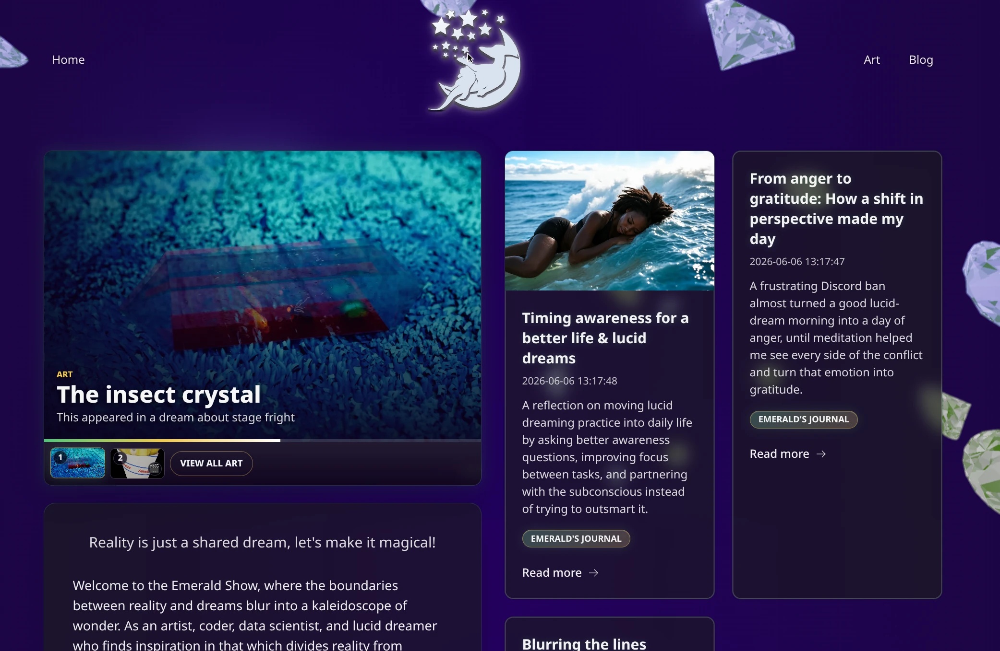

# Emerald Blog v3

Emerald Blog v3 is the current home of the Emerald Show: a dream-soaked blog, art gallery, and Nostr publishing experiment built with Rust, Leptos, and `libnostrblog`.

Posts are fetched from Nostr, rendered through Leptos routes at `/`, `/blog`, `/art`, and `/post/:slug`, and hydrated in the browser so the site can keep following new activity after the first page load. The look is very Emerald Show: glass panels, floating crystals, a rotating art showcase, and a custom animated background instead of a plain blog template.



The layout is custom, but the important parts are reusable. If you want to make your own Nostr-backed blog, start with the sister project: [libnostrblog](https://github.com/peterwilli/libnostrblog).

## Features

- **Nostr-backed publishing**: blog posts come from Nostr through `libnostrblog`, with server-side polling and optional client-side streaming for newer posts.
- **Server-rendered, hydrated pages**: the app supports full SSR, islands SSR, and one-shot static export paths depending on how much runtime you want to operate.
- **Moderated comments**: comments are fetched from Nostr, require approval, and can be reviewed from an admin moderation queue before appearing on post pages.
- **NIP-07 and anonymous comments**: visitors with a browser signer can publish signed comments, while visitors without one can submit a display-name comment for moderation.
- **Markdown editor**: the admin post editor includes Markdown authoring, shortcut buttons for common markup, source/display modes, featured images, and categories.
- **Art-first workflow**: art posts have a dedicated publisher, a gallery route, category filters, featured-art presentation, and a home-page carousel with filmstrip controls.
- **Author and profile details**: posts and comments resolve Nostr profile data when available, with fallbacks to npub/hex identifiers.
- **Cached SSR seed data**: the server keeps a synchronized post list and can fall back to cached posts if a startup fetch fails.
- **Safe Markdown rendering**: raw HTML from post Markdown is downgraded to text while tables, task lists, strikethrough, and smart punctuation remain enabled.
- **Custom browser assets**: `core-js` and `packages/emerald-background` build the Nostr/browser helper bundle and animated Emerald background into `public/emerald-core.js`.

## Prerequisites

Install the local build tools:

Commands below use npm. pnpm also works; add `p` to `npm` commands when using it.

```bash
rustup toolchain install nightly --allow-downgrade
rustup target add wasm32-unknown-unknown
cargo install cargo-leptos --locked
npm install
```

Install browser test dependencies when running end-to-end tests:

```bash
cd end2end && npm install
```

## JavaScript Assets

The Nostr/browser helper bundle and emerald background scene are built into `public/emerald-core.js`:

```bash
npm run build:core-js
```

Run this when changing files under `core-js/` or `packages/emerald-background/`.

## Development

Run the normal SSR/hydrated app:

```bash
npm run watch
```

This uses the `Cargo.toml` cargo-leptos defaults:

```toml
bin-features = ["ssr"]
lib-features = ["hydrate"]
```

The server fetches posts on startup and continues polling for newer posts. The client receives the SSR-seeded post list through Leptos resources.

## Deployment Paths

| Path | Best For | Pros | Cons |
| --- | --- | --- | --- |
| [Full SSR Build](docs/deployment/full-ssr.md) | A live server that should always show the newest posts and comments. | Fully SEO-optimized HTML for post routes; server keeps polling Nostr for new posts; full WASM can sync newer posts and comments in the browser; works well with dynamic routes and client-side navigation. | Requires an Axum server process; larger WASM than islands because the full app hydrates; operational work includes process hosting, logs, restarts, and runtime config. |
| [Islands SSR Build](docs/deployment/islands-ssr.md) | A live server with the smallest practical interactive WASM surface. | Fully SEO-optimized HTML for post routes; smaller WASM because only islands hydrate; posts are rendered from SSR state; Nostr actions like publishing comments still work through browser WASM. | Requires an Axum server process; browser does not add newly discovered posts to the list; less suitable if you need client-side post streaming or offline-first browsing. |
| [One-Shot SSR Then CSR](docs/deployment/one-shot-ssr-then-csr.md) | Static hosting while keeping client-side Nostr updates after the initial prerender. | Build-time posts and comments are prerendered and indexable; new posts/comments can still appear through full client-side Nostr sync; runs on any static file server or shared host; no server-side runtime to patch or monitor. | Larger WASM than islands; cannot use islands because dynamically adding new posts needs the full hydrated app/router; SEO only covers content present at export time; generated HTML must be rebuilt to make later posts available without JavaScript. |

## Testing

Run Rust tests:

```bash
cargo test
```

Run Playwright end-to-end tests:

```bash
cargo leptos end-to-end
```

For release-sensitive changes:

```bash
cargo leptos build --release
cargo leptos end-to-end --release
```
